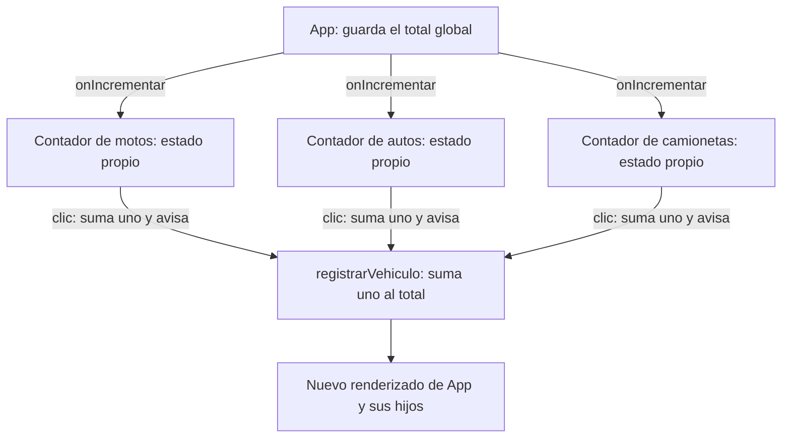

# Construir un mini React: componentes, estado y efectos

Vamos a construir una biblioteca pequeña para entender qué pasa cuando una aplicación cambia de estado. Tendrá `createElement`, componentes escritos como funciones, `useState` y `useEffect`. Cada actualización volverá a ejecutar la aplicación y reemplazará todos los elementos dentro de su contenedor.

La aplicación contará motos, autos y camionetas que pasan por una esquina. Mostrará las cantidades por categoría, el total, la hora de inicio, el tiempo transcurrido y el promedio de vehículos por hora.

**La idea central:** la pantalla se obtiene a partir del estado. Si cambia el estado, volvemos a calcular la pantalla.

```text
evento → actualizar estado → ejecutar componentes → reemplazar DOM → ejecutar efectos pendientes
```

Usamos JavaScript del navegador, sin JSX, dependencias, instalación ni compilación. `createElement` construye nodos reales: no guardaremos un árbol virtual ni compararemos árboles para decidir qué parte actualizar.

La [página lista para abrir](../clase/mini-react.html) también está incluida **completa al final de este apunte**. Los fragmentos de los niveles explican las piezas; el último bloque las integra en un único archivo HTML. Los ejemplos alternativos se prueban sustituyendo la aplicación de ese archivo, sin duplicar las declaraciones del framework.

## Nivel 1. De los datos a la pantalla

### Empezar con el DOM que ya conocemos

Un contador puede comenzar con una variable y una función que construye la pantalla:

```html
<div id="app"></div>
<script>
  let cantidad = 0;
  const contenedor = document.getElementById("app");

  function dibujar() {
    const boton = document.createElement("button");
    boton.textContent = `Motos: ${cantidad}`;
    boton.addEventListener("click", () => {
      cantidad++;
      dibujar();
    });
    contenedor.replaceChildren(boton);
  }

  dibujar();
</script>
```

Cada clic crea otro botón y lo coloca en el lugar del anterior. La variable `cantidad` sobrevive porque está fuera de `dibujar`; el botón anterior no sobrevive.

`replaceChildren` sustituye los hijos del contenedor por los nodos que le pasamos. El propio contenedor se conserva. [Referencia de MDN](https://developer.mozilla.org/en-US/docs/Web/API/Element/replaceChildren).

Separá dos ideas: **el dato se conserva; su representación se reconstruye**. El dato no tiene por qué vivir dentro del elemento HTML que lo muestra.

### Pregunta para la clase

¿Qué pasaría si `let cantidad = 0` estuviera dentro de `dibujar`? Cada ejecución crearía una variable nueva con valor cero. Necesitamos una memoria que dure más que una llamada a la función.

## Nivel 2. Escribir interfaces con `createElement`

Crear elementos uno por uno es repetitivo. Podemos envolver esas operaciones en una función:

```javascript
function createElement(etiqueta, props, ...hijos) {
  const elemento = document.createElement(etiqueta);

  for (const [nombre, valor] of Object.entries(props ?? {})) {
    if (nombre.startsWith("on") && typeof valor === "function") {
      elemento.addEventListener(nombre.slice(2).toLowerCase(), valor);
    } else if (nombre === "className") {
      elemento.className = valor ?? "";
    } else if (nombre === "disabled") {
      elemento.disabled = Boolean(valor);
    } else if (valor != null) {
      elemento.setAttribute(nombre, String(valor));
    }
  }

  for (const hijo of hijos.flat(Infinity)) {
    if (hijo == null || typeof hijo === "boolean") continue;
    elemento.append(
      hijo instanceof Node ? hijo : document.createTextNode(String(hijo))
    );
  }

  return elemento;
}
```

Ahora una interfaz se escribe como una expresión:

```javascript
const vista = createElement("section", { className: "contador" },
  createElement("h2", null, "Motos"),
  createElement("p", null, 0),
  createElement("button", {
    type: "button",
    onClick: () => console.log("Pasó una moto")
  }, "+1 moto")
);

document.getElementById("app").replaceChildren(vista);
```

El primer argumento indica qué crear; el segundo contiene propiedades y eventos; los siguientes son hijos. Los hijos pueden ser nodos, textos, números o arrays. `null`, `undefined` y los booleanos no producen contenido; el número `0` sí debe aparecer.

Los textos se crean con `createTextNode`: una cadena como `"<strong>Hola</strong>"` se muestra literalmente y no se interpreta como HTML.

Para evitar repetir un nombre largo, usaremos un alias:

```javascript
const h = createElement;
// h("p", null, "Hola") y createElement("p", null, "Hola") son lo mismo.
```

`h` es una función común. No introduce sintaxis nueva ni necesita un compilador.

Esta versión solo soporta las propiedades necesarias para la práctica: atributos, `className`, `disabled` y eventos nativos como `onClick`. No implementa toda la API de propiedades de React.

## Nivel 3. Un componente es una función

Un componente recibe datos y devuelve su representación:

```javascript
function Contador({ titulo, cantidad, onSumar }) {
  return h("section", null,
    h("h2", null, titulo),
    h("p", null, cantidad),
    h("button", { type: "button", onClick: onSumar }, "+1")
  );
}
```

Agregamos al comienzo de `createElement` una primera versión del soporte para componentes:

```javascript
if (typeof tipo === "function") {
  return tipo({ ...props, children: hijos });
}
```

Desde este nivel llamamos `tipo` al primer parámetro: puede ser una etiqueta o una función. Entonces podemos escribir:

```javascript
h(Contador, {
  titulo: "Motos",
  cantidad: 3,
  onSumar: () => console.log("Sumar una moto")
});
```

Pasamos `Contador`, la función, para que el framework la ejecute. Cuando agreguemos hooks, cada llamada a un hook ocupará una posición del array global de memoria.

**Componente e instancia no son lo mismo.** `Contador` es una función que podemos reutilizar; las tres llamadas a `h(Contador, ...)` representan tres instancias de esa misma función.

## Nivel 4. Guardar memoria con `useState`

### Por qué una variable local no alcanza

Este componente no conserva el conteo:

```javascript
function ContadorIncorrecto() {
  let cantidad = 0;
  return h("button", {
    onClick: () => cantidad++
  }, cantidad);
}
```

El clic modifica una variable, pero nadie vuelve a dibujar. Y si ejecutamos otra vez la función, la variable vuelve a cero.

Queremos escribir:

```javascript
function ContadorLocal({ titulo }) {
  const [cantidad, setCantidad] = useState(0);

  return h("button", {
    type: "button",
    onClick: () => setCantidad(anterior => anterior + 1)
  }, `${titulo}: ${cantidad}`);
}
```

`cantidad` es el valor para esta ejecución; `setCantidad` guarda otro valor y solicita un renderizado. Esta distinción coincide con el contrato básico de [`useState` de React](https://react.dev/reference/react/useState).

### Un array global y un contador global

Toda la memoria del framework se guarda en un único array. Un contador indica qué posición corresponde a la próxima llamada a un hook:

```javascript
const hooks = [];
let indiceHook = 0;
```

Estas variables se declaran fuera de los componentes, dentro de `MiniReact`. Son globales para la aplicación que monta este framework: todos sus componentes comparten el mismo array y el mismo contador.

El recorrido es sencillo:

1. Antes de ejecutar toda la aplicación, ponemos `indiceHook = 0`.
2. Cada `useState` o `useEffect` toma la posición indicada y aumenta el contador.
3. Si esa posición todavía no existe, creamos el registro del hook.
4. Si ya existe, recuperamos el registro guardado.

**Al redibujar reiniciamos el contador, no el array.** El contador no se reinicia al entrar en un hijo: continúa desde la posición que dejó el padre.

### Seguir las posiciones con tres contadores

En `AppLocales`, que usaremos al final de este nivel, el padre no tiene hooks y cada hijo llama una vez a `useState(0)`:

| Orden de llamada | Quién llama | Posición | Valor guardado de ejemplo |
|---|---|---|---:|
| Primera | Contador de motos | `hooks[0]` | 2 |
| Segunda | Contador de autos | `hooks[1]` | 5 |
| Tercera | Contador de camionetas | `hooks[2]` | 1 |

El array contiene registros, por ejemplo `{ tipo: "estado", valor: 2, set: ... }`; la tabla muestra solo sus valores. Cada cuenta ocupa una posición diferente aunque las tres llamadas estén escritas en la misma función `ContadorLocal`.

Al sumar una moto, su setter cambia el valor guardado en `hooks[0]` a `3`. En el siguiente renderizado ponemos `indiceHook = 0` y recorremos otra vez las mismas llamadas: motos recupera `3`, autos recupera `5` y camionetas recupera `1`.

El framework no conoce el nombre de la variable ni la categoría del vehículo. Asocia cada hook con su **orden de llamada dentro de toda la aplicación**. Por eso mantenemos fijos los componentes y el orden y la cantidad de hooks durante un montaje. Cambiar ese recorrido podría hacer que una llamada lea la memoria de otra.

### Obtener el siguiente hook

Tanto `useState` como `useEffect` usarán esta función:

```javascript
function siguienteHook(tipo, crear) {
  if (!renderizando) throw new Error("Los hooks se llaman dentro de un componente.");
  const posicion = indiceHook;
  indiceHook = indiceHook + 1;
  const hook = hooks[posicion] ??= { tipo, ...crear() };
  if (hook.tipo !== tipo) throw new Error("No cambies el orden de los hooks.");
  return hook;
}
```

Primero guardamos la posición; después aumentamos el contador. `??=` crea el registro solamente si todavía no existe. El campo `tipo` permite detectar, por ejemplo, que una posición usada por un estado se intente usar luego para un efecto. Dos estados intercambiados no se detectan con esta comprobación.

`renderizando` es una bandera que vale `true` mientras se ejecuta la aplicación para construir su interfaz. Evita usar hooks desde eventos o fuera de ese recorrido. No identifica componentes ni guarda sus datos.

### Implementar `useState`

```javascript
function useState(inicial) {
  const montaje = generacion;
  const hook = siguienteHook("estado", () => ({
    valor: typeof inicial === "function" ? inicial() : inicial
  }));

  hook.set ??= (nuevo) => {
    if (montaje !== generacion) return;
    if (renderizando) throw new Error("Actualizá el estado en eventos o efectos, no al renderizar.");
    const valor = typeof nuevo === "function" ? nuevo(hook.valor) : nuevo;
    if (Object.is(valor, hook.valor)) return;
    hook.valor = valor;
    programarRender();
  };

  return [hook.valor, hook.set];
}
```

El setter conserva una referencia al registro de su hook mediante una clausura. Cuando llega un clic, usa ese registro, aunque `indiceHook` ya haya avanzado. No consulta el contador global para decidir qué estado cambiar. `montaje` permite ignorar setters viejos después de reiniciar toda la aplicación.

El inicializador se usa una sola vez por montaje. Podemos pasar `0` o una función como `() => Date.now()`. No comprobamos si el valor es verdadero para decidir si existe: `0`, `false`, `null` y `undefined` también son estados válidos.

El setter acepta un valor directo o una función que recibe el anterior. Si no hay cambio según `Object.is`, no solicita otro renderizado.

### Programar el siguiente renderizado

```javascript
function programarRender() {
  if (pendiente) return;
  pendiente = true;
  const turno = generacion;
  queueMicrotask(() => {
    if (turno !== generacion) return;
    pendiente = false;
    if (raiz) redibujar();
  });
}
```

Una microtarea permite terminar el código actual antes de reconstruir la pantalla. Si un evento cambia varios estados, todos se reflejan juntos. El DOM sigue reemplazándose entero; no hay comparación de nodos. [Referencia de `queueMicrotask`](https://developer.mozilla.org/en-US/docs/Web/API/Window/queueMicrotask).

`generacion` identifica el montaje actual. Al desmontar incrementamos ese número: una actualización pendiente del montaje anterior ya no puede redibujar una aplicación nueva.

En esta implementación el setter modifica la memoria inmediatamente y difiere el renderizado. React tiene su propio procesamiento de actualizaciones; aquí estamos construyendo una aproximación didáctica, no copiando su implementación interna.

### Volver a recorrer el array al redibujar

Este es el núcleo de `redibujar`. Antes de llamar a la raíz ponemos el contador en cero; las llamadas de todos los componentes lo van aumentando:

```javascript
function redibujar() {
  indiceHook = 0;
  efectos = [];
  let vista;
  renderizando = true;
  try {
    vista = createElement(raiz, null);
  } finally {
    renderizando = false;
  }
  contenedor.replaceChildren(vista);
  const pendientes = efectos;
  efectos = [];
  for (const ejecutar of pendientes) ejecutar();
}
```

La lista `efectos` reúne las tareas que deben ejecutarse después de colocar el DOM; la implementaremos en el nivel 6. La versión completa también recupera el foco del botón que se reemplazó.

`hooks.length = 0` no aparece en este redibujado: borraría los estados. Vaciamos el array únicamente cuando desmontamos o reiniciamos toda la aplicación.

### Probar tres estados independientes

Con el framework completo del final, reemplazá la aplicación por estas funciones y el montaje:

```javascript
function ContadorLocal({ titulo }) {
  const [cantidad, setCantidad] = useState(0);
  return h("button", {
    type: "button",
    onClick: () => setCantidad(anterior => anterior + 1)
  }, `${titulo}: ${cantidad}`);
}

function AppLocales() {
  return h("main", null,
    h(ContadorLocal, { titulo: "Motos" }),
    h(ContadorLocal, { titulo: "Autos" }),
    h(ContadorLocal, { titulo: "Camionetas" })
  );
}

MiniReact.render(AppLocales, document.getElementById("app"));
```

Al incrementar motos, las tres funciones de contador vuelven a ejecutarse, pero solo cambia el estado de motos. Los valores de autos y camionetas se recuperan de sus propias posiciones.

## Nivel 5. Cada hijo cuenta y avisa al padre

Cada `Contador` conserva su propia `cantidad` con `useState`. `App` conserva un contador global llamado `total`. El padre pasa la misma función `registrarVehiculo` a los tres hijos mediante la propiedad `onIncrementar`.

```javascript
function Contador({ titulo, onIncrementar }) {
  const [cantidad, setCantidad] = useState(0);

  function incrementar() {
    setCantidad(anterior => anterior + 1);
    onIncrementar();
  }

  return h("section", null,
    h("h2", null, titulo),
    h("p", null, cantidad),
    h("button", { type: "button", onClick: incrementar }, "+1")
  );
}

function App() {
  const [total, setTotal] = useState(0);

  function registrarVehiculo() {
    setTotal(anterior => anterior + 1);
  }

  return h("main", null,
    h("p", null, `Total: ${total}`),
    h(Contador, { titulo: "Motos", onIncrementar: registrarVehiculo }),
    h(Contador, { titulo: "Autos", onIncrementar: registrarVehiculo }),
    h(Contador, { titulo: "Camionetas", onIncrementar: registrarVehiculo })
  );
}
```

El handler del hijo hace dos cosas: incrementa su cuenta interna y llama a `onIncrementar()`. Esa llamada ejecuta la función del padre, que incrementa su propio estado. Las dos actualizaciones se reflejan juntas en el siguiente renderizado.



El padre recibe un aviso por vehículo; no necesita conocer qué categoría cambió. Cada hijo administra su cantidad, y el padre administra el total. Es un ejemplo de comunicación mediante [funciones recibidas como propiedades](https://react.dev/learn/responding-to-events#passing-event-handlers-as-props).

El contrato es sencillo: **por cada incremento local, un aviso al padre**. Ambos empiezan en cero y se reinician juntos; por eso el total coincide con la suma de las cuentas. Si se agregaran otras operaciones, también habría que definir cómo informarlas.

La notificación ocurre en el handler del clic. No se coloca dentro del actualizador `anterior => anterior + 1`, cuya tarea es calcular el próximo valor, ni en un efecto que observe la cantidad. Así cada clic genera exactamente un aviso.

## Nivel 6. Ejecutar tareas con `useEffect`

Un componente se ejecuta muchas veces. Si creamos un intervalo directamente en su cuerpo, cada renderizado agrega otro reloj. Después de varios clics habrá varios intervalos trabajando a la vez.

`useEffect` permite declarar una tarea que se ejecutará después de instalar el DOM, según sus dependencias. Puede devolver una función para liberar lo que creó.

```javascript
useEffect(() => {
  const intervalo = setInterval(() => setAhora(Date.now()), 1000);
  return () => clearInterval(intervalo);
}, []);
```

El array vacío indica una vez por montaje. Los clics y los ticks conservan ese intervalo. Al reiniciar desmontamos toda la aplicación: la limpieza cancela el reloj anterior y el nuevo montaje crea otro.

| Forma | Cuándo se ejecuta en nuestro framework |
|---|---|
| `useEffect(tarea)` | Después de cada renderizado |
| `useEffect(tarea, [])` | Una vez por montaje |
| `useEffect(tarea, [valor])` | Al montar y cuando cambia `valor` |
| `return limpiar` dentro de `tarea` | Antes de repetir esa tarea y al desmontar |

Estas son las ideas básicas de las dependencias y la limpieza de [`useEffect`](https://react.dev/reference/react/useEffect). Nuestro framework ejecuta los efectos inmediatamente después de sustituir el DOM; no reproduce la planificación ni el comportamiento de desarrollo de React.

### Implementar las dependencias y la limpieza

```javascript
function useEffect(ejecutar, dependencias) {
  const hook = siguienteHook("efecto", () => ({
    iniciado: false, dependencias: undefined, limpiar: undefined
  }));

  const cambio = !hook.iniciado || dependencias === undefined ||
    hook.dependencias === undefined ||
    dependencias.length !== hook.dependencias.length ||
    dependencias.some((valor, i) => !Object.is(valor, hook.dependencias[i]));

  if (cambio) {
    hook.iniciado = true;
    hook.dependencias = dependencias?.slice();
    efectos.push(() => {
      hook.limpiar?.();
      const limpieza = ejecutar();
      hook.limpiar = typeof limpieza === "function" ? limpieza : undefined;
    });
  }
}
```

Durante el renderizado solo anotamos los efectos pendientes. Después de `contenedor.replaceChildren(vista)` ejecutamos esa lista. Un efecto puede consultar la pantalla recién instalada.

Las dependencias se comparan por valor o identidad con `Object.is`, sin comparación profunda de objetos. En el código de los componentes mantenemos estable el número y el orden de las dependencias.

Si una tarea abre un intervalo o registra un listener externo, debe devolver su limpieza. No hace falta limpiar manualmente los listeners de los botones que construye `createElement`: los viejos botones se descartan junto con sus listeners cuando dejan de tener referencias.

### Estado y efecto tienen trabajos distintos

El setter devuelto por `useState` solicita el renderizado. `useEffect` no observa variables comunes ni solicita un renderizado por sí solo. En el reloj, el camino es:

```text
useEffect crea un intervalo una vez por montaje
    ↓
el intervalo llama a setAhora(Date.now()) cada segundo
    ↓
setAhora guarda el dato y solicita el renderizado
    ↓
App y los tres Contador se ejecutan otra vez
    ↓
la pantalla se reemplaza; el intervalo existente continúa
```

Este efecto sería incorrecto porque produce un ciclo sin fin:

```javascript
// No ejecutar: cambia el estado después de cada renderizado.
useEffect(() => setCantidad(anterior => anterior + 1));
```

El aviso al padre pertenece al evento del clic. No hace falta un efecto para comunicarlo. En esta aplicación usamos `useEffect` solamente para crear el intervalo y devolver su limpieza.

## Nivel 7. Agregar el reloj y calcular vehículos por hora

En la aplicación completa `App` conserva tres estados:

```javascript
const [total, setTotal] = useState(0);
const [inicio] = useState(() => Date.now());
const [ahora, setAhora] = useState(inicio);
```

La observación comienza al abrir la página. `inicio` se conserva durante todo el montaje; `ahora` se actualiza cada segundo y también al registrar un vehículo. Cada hijo conserva, por separado, su propia `cantidad`. El flujo por hora se calcula y se muestra solo en el resumen global del padre.

En la aplicación completa el orden global es este:

| Posición | Componente | Hook |
|---|---|---|
| `hooks[0]` | `App` | Estado del total |
| `hooks[1]` | `App` | Estado del inicio |
| `hooks[2]` | `App` | Estado de la hora actual |
| `hooks[3]` | `App` | Efecto del intervalo |
| `hooks[4]` | `Contador` de motos | Estado de su cantidad |
| `hooks[5]` | `Contador` de autos | Estado de su cantidad |
| `hooks[6]` | `Contador` de camionetas | Estado de su cantidad |

El contador global recorre de `0` a `6` y queda en `7`. El próximo renderizado vuelve a empezar en `0`. El efecto también ocupa una posición: conserva allí sus dependencias y su función de limpieza. Cada contador administra su estado mediante su setter; el almacenamiento compartido no mezcla las cuentas.


```javascript
const transcurrido = Math.max(0, ahora - inicio);
const promedio = transcurrido > 0
  ? total * 3_600_000 / transcurrido
  : null;
```

`Date.now()` devuelve milisegundos. Una hora tiene `3.600.000` milisegundos. Dividimos el total por el tiempo observado expresado en horas.

| Dato de ejemplo | Valor |
|---|---:|
| Motos | 5 |
| Autos | 3 |
| Camionetas | 2 |
| Total | 10 |
| Tiempo observado | 120 segundos |
| Promedio | `10 × 3600 / 120 = 300 vehículos/hora` |

Es el **caudal medio observado**, proyectado a una hora si se mantuviera ese ritmo. No representa la velocidad física de los vehículos ni garantiza cuántos pasarán durante la próxima hora. Para calcular km/h necesitaríamos distancias y tiempos de recorrido.

Cuando el tiempo es cero mostramos `—` y evitamos dividir por cero. Si el tiempo es positivo pero todavía no pasó ningún vehículo, el promedio es cero. Durante los primeros segundos el promedio puede ser alto y variar mucho.

El intervalo no suma un segundo a una variable: toma la hora real y vuelve a restar el inicio. Así un retraso del intervalo no hace perder segundos. Como usamos el reloj del sistema, un cambio manual de ese reloj puede afectar la duración; para una aplicación de medición más exigente se puede separar la hora civil del tiempo monotónico medido con `performance.now()`.

### Reiniciar todos los estados

Cada contador tiene un único botón para sumar. Para comenzar una nueva observación, volvemos a montar la aplicación completa:

```javascript
function reiniciar() {
  MiniReact.render(App, document.getElementById("app"));
}
```

En nuestro framework, `render` primero desmonta la raíz anterior. Se limpia el intervalo y se vacía el array global de hooks. El nuevo montaje inicia el total y las tres cuentas en cero, toma una nueva hora de inicio y crea un intervalo nuevo.

Esto es distinto de redibujar: el redibujado conserva los hooks; un nuevo montaje comienza desde cero. El título de la página permanece fijo.

## Nivel 8. Seguir un clic de principio a fin

Supongamos que tenemos dos motos, un auto y ninguna camioneta:

1. El contador de motos guarda `cantidad = 2` y `App` guarda `total = 3`.
2. El usuario pulsa `+1 moto` en el componente hijo.
3. Su handler llama a `setCantidad(anterior => anterior + 1)`: motos pasa a tres.
4. Luego llama a `onIncrementar()`, que ejecuta `registrarVehiculo` en el padre.
5. El padre llama a `setTotal(anterior => anterior + 1)`: el total pasa a cuatro. También actualiza `ahora` para la lectura del flujo.
6. Al terminar el handler, una sola microtarea ejecuta de nuevo `App` y los tres hijos.
7. Las llamadas recuperan las mismas posiciones del array global: motos muestra tres, autos uno, camionetas cero y el padre muestra cuatro.
8. `createElement` crea nodos nuevos y `replaceChildren` reemplaza todo el contenido de `#app`.
9. El efecto con `[]` conserva el intervalo existente. El flujo global se recalcula con el total y el tiempo actuales.

El callback es el vínculo explícito entre hijo y padre. No es una modificación automática del estado del padre por tener un hijo, ni depende de la propagación del evento DOM.

En este mini framework **cualquier cambio de estado redibuja desde la raíz**. No extrapoles esa política a React real: aquí la elegimos para poder ver el ciclo completo sin agregar optimizaciones.

## Nivel 9. Qué conservamos y qué descartamos

| Se conserva entre renderizados | Se vuelve a crear |
|---|---|
| Array global de hooks | Nodos dentro de `#app` |
| Valores de los hooks | Variables locales del componente |
| Identidad de cada setter | Funciones de evento declaradas en cada ejecución |
| Dependencias y limpieza de efectos | Representación de cantidades, total y tiempo |
| Intervalo si sus dependencias no cambian | Botones y sus listeners |

Reemplazar el DOM **conserva el array global de hooks**. Si lo vaciáramos en cada renderizado, todos los contadores volverían a cero y todos los efectos comenzarían otra vez. Solo `indiceHook` vuelve a cero para recorrer los mismos registros.

`MiniReact.unmount()` sí desmonta la aplicación: ejecuta las limpiezas, descarta los hooks y vacía el contenedor. Otro `MiniReact.render(App, contenedor)` comienza desde cero. Un setter guardado de un montaje anterior se ignora porque su `montaje` ya no coincide con `generacion`.

El reemplazo del DOM también puede perder el foco. La versión completa recuerda el `id` del botón enfocado y enfoca su reemplazo. No conserva los nodos ni implementa reconciliación. Esta ayuda sirve para los botones de la práctica; no resuelve selección de texto, formularios complejos ni todos los comportamientos de accesibilidad de una aplicación real.

### Límites deliberados de esta versión

- **Una raíz y una secuencia global fija de hooks.** No hay un registro de instancias ni identidades por `key`: todos los hooks ocupan posiciones del mismo array. No insertar, quitar, reordenar ni cambiar condicionalmente componentes durante un montaje. Cada renderizado ejecuta toda la aplicación.
- **Hooks incondicionales y en orden fijo.** No llamarlos dentro de eventos, bucles o condiciones. Las comprobaciones del ejemplo detectan algunos errores, no todos.
- **DOM real inmediato.** `h` devuelve nodos reales y ejecuta componentes durante la evaluación de JavaScript. No tiene la semántica completa de los elementos y de `children` de React; este ejemplo usa composición fija y directa.
- **Propiedades limitadas.** Se incluyen atributos, textos, `className`, `disabled` y listeners nativos. No se implementan objetos `style`, referencias, eventos sintéticos ni el manejo completo de formularios de React.
- **Efectos después del reemplazo.** No se garantiza que el navegador ya haya pintado; no hay Strict Mode, renderizado concurrente ni recuperación de errores.
- **Desmontaje de toda la raíz.** La limpieza de componentes individuales retirados condicionalmente queda fuera del modelo de árbol fijo.
- **Sin almacenamiento persistente.** Recargar la página comienza otra observación.

Estas restricciones forman parte del ejercicio. La biblioteca permite estudiar el mecanismo básico; no está destinada a reemplazar React en aplicaciones reales.

## Nivel 10. Actividades para enseñar y comprobar

### Demostración en clase

1. Abrí el archivo HTML. Comprobá que empieza con cero y que avanza el tiempo sin tocar botones.
2. Registrá dos motos, un auto y una camioneta. Deben aparecer `2`, `1`, `1` y un total de `4`.
3. Sumá otra moto: solo su cuenta pasa a `3`; el total pasa a `5`.
4. Esperá unos segundos sin contar: las cuentas y el total quedan iguales; el flujo global por hora disminuye.
5. Reiniciá: las cuatro cuentas vuelven a cero, cambia la hora de inicio y el tiempo vuelve a empezar.
6. Navegá con Tab y activá un botón con Enter. El foco debe permanecer en su reemplazo.

### Mirar el reemplazo del DOM

En la consola del navegador:

```javascript
const botonAnterior = document.getElementById("sumar-motos");
botonAnterior.click();

// Ejecutar esta comparación después de procesar la actualización:
queueMicrotask(() => {
  console.log(botonAnterior === document.getElementById("sumar-motos")); // false
  console.log(botonAnterior.isConnected); // false
});
```

La cantidad persiste aunque el botón sea otro objeto. También sucede cuando el reloj solicita una actualización.

### Experimentos con estado y efectos

- Sustituí la aplicación por `AppLocales` del nivel 4 para observar tres valores independientes en el mismo array global. Después agregá el total en el padre y el aviso `onIncrementar` de cada hijo.
- Agregá temporalmente `console.count("App")` y `console.count("Contador: " + titulo)` dentro de esas funciones. Cada clic y cada tick ejecutan todas las instancias.
- En el efecto del intervalo registrá `console.log("crear intervalo")` y en su limpieza `console.log("limpiar intervalo")`. Un clic para contar no debe crear un intervalo; reiniciar debe limpiar el anterior y crear otro.
- Usá `MiniReact.unmount()` en la consola. La pantalla se vacía y el intervalo debe cancelarse. Para volver, ejecutá `MiniReact.render(App, document.getElementById("app"))`.
- Calculá en papel el promedio de 15 vehículos en 90 segundos. El resultado esperado es `600 vehículos/hora`.

En un contador local, compará estos dos handlers:

```javascript
// Ambas llamadas usan la misma cantidad de esta ejecución: incrementa uno.
onClick: () => {
  setCantidad(cantidad + 1);
  setCantidad(cantidad + 1);
}

// Cada llamada recibe el último valor guardado: incrementa dos.
onClick: () => {
  setCantidad(anterior => anterior + 1);
  setCantidad(anterior => anterior + 1);
}
```

Como extensión, agregá un cuarto `Contador` de colectivos de manera fija en el código y pasale el mismo `onIncrementar: registrarVehiculo`. Tendrá su propio estado y sus clics también incrementarán el total, sin cambiar la lógica del padre. Para practicar la limpieza del efecto, comprobá que reiniciar varias veces siempre deja un solo intervalo activo.

## Página completa, autocontenida

Guardá el siguiente bloque como `mini-react.html` y abrilo con doble clic. Incluye estilos, framework y aplicación; funciona sin conexión y sin servidor. Es el mismo contenido que [la página de la carpeta `clase`](../clase/mini-react.html).

<!-- PAGINA_COMPLETA: el bloque siguiente debe coincidir con clase/mini-react.html. -->

```html
<!doctype html>
<html lang="es">
<head>
  <meta charset="utf-8">
  <meta name="viewport" content="width=device-width, initial-scale=1">
  <title>Tránsito en la esquina · Mini React</title>
  <style>
    * { box-sizing: border-box; }
    body {
      margin: 0;
      background: #f5f4ef;
      color: #202b29;
      font: 16px/1.5 system-ui, sans-serif;
    }
    main { max-width: 1000px; margin: 0 auto; padding: 48px 24px; }
    header { border-bottom: 1px solid #ccd2cc; padding-bottom: 28px; }
    .ceja { color: #52635c; font-size: .75rem; font-weight: 750; letter-spacing: .12em; }
    h1 { margin: 12px 0; font-size: clamp(2rem, 5vw, 3.2rem); line-height: 1.1; letter-spacing: -.04em; }
    h2, p { margin: 0; }
    .descripcion, .nota { color: #52635c; }
    .sesion { display: flex; justify-content: space-between; align-items: center; gap: 20px; margin: 24px 0; }
    .sesion p { font-size: .9rem; }
    button {
      min-height: 44px;
      padding: 10px 16px;
      border: 1px solid #aab5ad;
      border-radius: 6px;
      background: transparent;
      color: inherit;
      font: inherit;
      font-weight: 650;
      cursor: pointer;
      touch-action: manipulation;
    }
    button:hover:not(:disabled) { filter: brightness(.92); }
    button:focus-visible { outline: 3px solid #184fc6; outline-offset: 4px; }
    button:disabled { color: #68726d; background: #f0f1ed; cursor: default; }
    .resumen { display: grid; grid-template-columns: repeat(3, 1fr); margin: 0 0 32px; padding: 24px 0; border-block: 1px solid #ccd2cc; }
    .resumen div { padding: 0 24px; border-left: 1px solid #ccd2cc; }
    .resumen div:first-child { padding-left: 0; border-left: 0; }
    dt { color: #52635c; font-size: .88rem; }
    dd { margin: 4px 0 0; font-size: clamp(1.6rem, 4vw, 2.5rem); font-weight: 750; letter-spacing: -.04em; }
    dd, .cantidad { font-variant-numeric: tabular-nums; }
    .contadores { display: grid; grid-template-columns: repeat(3, 1fr); gap: 20px; }
    .contador { padding: 24px; background: #fff; border: 1px solid #d7dcd6; border-top: 4px solid var(--acento); border-radius: 6px; }
    .motos { --acento: #974825; }
    .autos { --acento: #24624c; }
    .camionetas { --acento: #3c5479; }
    .contador h2 { font-size: 1.15rem; color: var(--acento); }
    .cantidad { margin: 12px 0 20px; font-size: 4.5rem; line-height: 1.2; font-weight: 750; letter-spacing: -.06em; }
    .sumar { width: 100%; border-color: var(--acento); background: var(--acento); color: white; }
    footer { margin-top: 28px; font-size: .85rem; }
    footer p + p { margin-top: 8px; }
    @media (max-width: 650px) {
      main { padding: 28px 18px; }
      .sesion { align-items: flex-start; flex-direction: column; gap: 12px; }
      .resumen { gap: 18px; grid-template-columns: 1fr; }
      .resumen div { padding: 0; border: 0; }
      .resumen dd { font-size: 2rem; }
      .contadores { grid-template-columns: 1fr; }
      .contador { padding: 20px; }
      .cantidad { font-size: 3.5rem; margin: 8px 0 16px; }
    }
  </style>
</head>
<body>
  <div id="app"></div>
  <noscript>Activá JavaScript para usar los contadores.</noscript>

  <script>
    "use strict";

    // MINI FRAMEWORK: DOM real, un array global de hooks y un orden fijo.
    const MiniReact = (() => {
      let raiz = null;
      let contenedor = null;
      const hooks = [];
      let indiceHook = 0;
      let renderizando = false;
      let pendiente = false;
      let generacion = 0;
      let efectos = [];

      function createElement(tipo, props, ...hijos) {
        props ??= {};

        if (typeof tipo === "function") {
          return tipo({ ...props, children: hijos });
        }

        const elemento = document.createElement(tipo);
        for (const [nombre, valor] of Object.entries(props)) {
          if (nombre.startsWith("on") && typeof valor === "function") {
            elemento.addEventListener(nombre.slice(2).toLowerCase(), valor);
          } else if (nombre === "className") {
            elemento.className = valor ?? "";
          } else if (nombre === "disabled") {
            elemento.disabled = Boolean(valor);
          } else if (valor != null) {
            elemento.setAttribute(nombre, String(valor));
          }
        }
        for (const hijo of hijos.flat(Infinity)) {
          if (hijo == null || typeof hijo === "boolean") continue;
          elemento.append(hijo instanceof Node ? hijo : document.createTextNode(String(hijo)));
        }
        return elemento;
      }

      function siguienteHook(tipo, crear) {
        if (!renderizando) throw new Error("Los hooks se llaman dentro de un componente.");
        const posicion = indiceHook;
        indiceHook = indiceHook + 1;
        const hook = hooks[posicion] ??= { tipo, ...crear() };
        if (hook.tipo !== tipo) throw new Error("No cambies el orden de los hooks.");
        return hook;
      }

      function programarRender() {
        if (pendiente) return;
        pendiente = true;
        const turno = generacion;
        queueMicrotask(() => {
          if (turno !== generacion) return;
          pendiente = false;
          if (raiz) redibujar();
        });
      }

      function useState(inicial) {
        const montaje = generacion;
        const hook = siguienteHook("estado", () => ({
          valor: typeof inicial === "function" ? inicial() : inicial
        }));
        hook.set ??= (nuevo) => {
          if (montaje !== generacion) return;
          if (renderizando) throw new Error("Actualizá el estado en eventos o efectos, no al renderizar.");
          const valor = typeof nuevo === "function" ? nuevo(hook.valor) : nuevo;
          if (Object.is(valor, hook.valor)) return;
          hook.valor = valor;
          programarRender();
        };
        return [hook.valor, hook.set];
      }

      function useEffect(ejecutar, dependencias) {
        const hook = siguienteHook("efecto", () => ({
          iniciado: false, dependencias: undefined, limpiar: undefined
        }));
        const cambio = !hook.iniciado || dependencias === undefined ||
          hook.dependencias === undefined ||
          dependencias.length !== hook.dependencias.length ||
          dependencias.some((valor, i) => !Object.is(valor, hook.dependencias[i]));

        if (cambio) {
          hook.iniciado = true;
          hook.dependencias = dependencias?.slice();
          efectos.push(() => {
            hook.limpiar?.();
            const limpieza = ejecutar();
            hook.limpiar = typeof limpieza === "function" ? limpieza : undefined;
          });
        }
      }

      function redibujar() {
        // Reiniciamos el contador global, pero conservamos el array de hooks.
        indiceHook = 0;
        efectos = [];
        // Los botones tienen id estable: recuperamos el foco tras reemplazarlos.
        const foco = contenedor.contains(document.activeElement) ? document.activeElement.id : "";
        let vista;
        renderizando = true;
        try {
          vista = createElement(raiz, null);
        } finally {
          renderizando = false;
        }
        contenedor.replaceChildren(vista);
        if (foco) document.getElementById(foco)?.focus({ preventScroll: true });
        // Los efectos ven el DOM ya instalado. No se espera al pintado del navegador.
        const pendientes = efectos;
        efectos = [];
        for (const ejecutar of pendientes) ejecutar();
      }

      function unmount() {
        raiz = null;
        generacion++;
        pendiente = false;
        for (const hook of hooks) {
          if (hook.tipo === "efecto") hook.limpiar?.();
        }
        hooks.length = 0;
        indiceHook = 0;
        efectos = [];
        contenedor?.replaceChildren();
        contenedor = null;
      }

      function render(Componente, destino) {
        unmount();
        raiz = Componente;
        contenedor = destino;
        redibujar();
      }

      return { createElement, useState, useEffect, render, unmount };
    })();

    // APLICACIÓN: esta parte solo usa la API pública del mini framework.
    const { createElement: h, useState, useEffect } = MiniReact;

    function formatearTiempo(milisegundos) {
      const segundos = Math.floor(milisegundos / 1000);
      const horas = Math.floor(segundos / 3600);
      const minutos = Math.floor((segundos % 3600) / 60);
      return [horas, minutos, segundos % 60]
        .map(numero => String(numero).padStart(2, "0")).join(":");
    }

    function calcularPromedio(total, milisegundos) {
      return milisegundos > 0 ? total * 3_600_000 / milisegundos : null;
    }

    function Contador({ tipo, titulo, singular, onIncrementar }) {
      const [cantidad, setCantidad] = useState(0);

      function incrementar() {
        setCantidad(anterior => anterior + 1);
        onIncrementar();
      }

      return h("section", { className: `contador ${tipo}` },
        h("h2", null, titulo),
        h("p", { className: "cantidad", id: `cantidad-${tipo}` }, cantidad),
        h("button", {
          type: "button", id: `sumar-${tipo}`, className: "sumar",
          onClick: incrementar
        }, `+1 ${singular}`)
      );
    }

    function App() {
      const [total, setTotal] = useState(0);
      const [inicio] = useState(() => Date.now());
      const [ahora, setAhora] = useState(inicio);

      // Un intervalo por montaje. Al desmontar se cancela.
      useEffect(() => {
        const intervalo = setInterval(() => setAhora(Date.now()), 1000);
        return () => clearInterval(intervalo);
      }, []);

      const transcurrido = Math.max(0, ahora - inicio);
      const promedio = calcularPromedio(total, transcurrido);

      function registrarVehiculo() {
        setTotal(anterior => anterior + 1);
        setAhora(Date.now());
      }

      function reiniciar() {
        MiniReact.render(App, document.getElementById("app"));
      }

      return h("main", null,
        h("header", null,
          h("p", { className: "ceja" }, "OBSERVACIÓN DE TRÁNSITO"),
          h("h1", null, "Tránsito en la esquina"),
          h("p", { className: "descripcion" }, "Registrá cada vehículo que pasa. Un clic, un vehículo.")
        ),
        h("div", { className: "sesion" },
          h("p", null, "Inicio del conteo: ",
            h("time", { id: "inicio", datetime: new Date(inicio).toISOString() },
              new Date(inicio).toLocaleString("es-AR", { hour12: false }))
          ),
          h("button", { type: "button", id: "reiniciar", onClick: reiniciar }, "Reiniciar conteo")
        ),
        h("dl", { className: "resumen" },
          h("div", null, h("dt", null, "Vehículos en total"), h("dd", { id: "total" }, total)),
          h("div", null, h("dt", null, "Tiempo transcurrido"), h("dd", { id: "tiempo" }, formatearTiempo(transcurrido))),
          h("div", null, h("dt", null, "Flujo global · vehículos/hora"), h("dd", { id: "promedio" },
            promedio === null ? "—" : promedio.toLocaleString("es-AR", { maximumFractionDigits: 1 })))
        ),
        h("div", { className: "contadores" },
          h(Contador, {
            tipo: "motos", titulo: "Motos", singular: "moto",
            onIncrementar: registrarVehiculo
          }),
          h(Contador, {
            tipo: "autos", titulo: "Autos", singular: "auto",
            onIncrementar: registrarVehiculo
          }),
          h(Contador, {
            tipo: "camionetas", titulo: "Camionetas", singular: "camioneta",
            onIncrementar: registrarVehiculo
          })
        ),
        h("footer", { className: "nota" },
          h("p", null, "El promedio proyecta a una hora el caudal observado desde el inicio; no mide velocidad en km/h. Con pocos segundos de observación puede variar mucho."),
          h("p", null, "Reiniciar o recargar la página comienza un conteo nuevo. Los datos de esta práctica no se guardan.")
        )
      );
    }

    MiniReact.render(App, document.getElementById("app"));
  </script>
</body>
</html>
```
