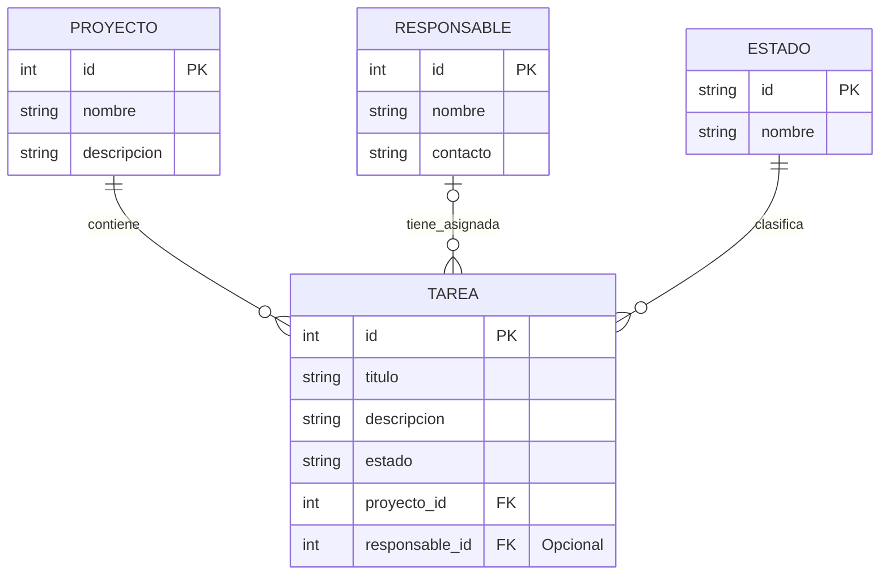

# Gestión de proyectos

Desarrollar una aplicación web sencilla para administrar múltiples proyectos, sus tareas y responsables. Debe permitir crear, consultar, modificar y eliminar estos elementos, asignar o quitar responsables y consultar las tareas de cada proyecto o responsable. Los estados de las tareas son configurables: se pueden agregar, renombrar, ordenar y eliminar si no tienen tareas asignadas. Cada tarea nueva comienza en el primer estado y el último se considera finalizado para calcular el avance de los proyectos. Al eliminar un proyecto se eliminan también sus tareas, previa confirmación; un responsable con tareas asignadas no puede eliminarse hasta que se reasignen o queden sin asignar.

El panel central debe mostrar las tareas de todos los proyectos en un tablero Kanban con una columna por estado. Cada tarjeta debe permitir asignar o quitar un responsable y cambiar de estado mediante flechas en su cabecera o arrastrándola a una columna contigua. Las tareas solo pueden moverse entre estados contiguos; el tablero debe indicar visualmente los destinos permitidos y los no permitidos. El tablero debe ofrecer búsqueda en vivo y filtros combinables por proyecto y responsable, incluida la opción de tareas sin asignar. No debe incluir un filtro por estado ni un resumen de trabajo. Las tareas de cada proyecto también deben poder consultarse en un tablero Kanban.

Durante el desarrollo se utilizará JSON Server para simular el servidor y conservar los datos en `db.json`, que contiene cinco proyectos de ejemplo con cinco tareas cada uno. La interfaz debe seguir el estilo del mockup `mockup.html`, inspirado en shadcn, y funcionar en computadoras y dispositivos móviles.

Para representar la información se necesita guardar, de cada proyecto, un identificador, un nombre y una descripción. De cada responsable se necesita un identificador, un nombre y un dato de contacto. Cada tarea debe tener un identificador, un título, una descripción y una referencia al estado configurado, además de una referencia al proyecto al que pertenece y otra al responsable asignado. Un proyecto puede tener muchas tareas y un responsable puede estar a cargo de varias; una tarea pertenece a un solo proyecto y puede tener un responsable o quedar sin asignar.

## Diagrama de entidad–relación

Los estados se guardan en una lista ordenada dentro de la configuración. Inicialmente son **pendiente**, **en desarrollo** y **finalizada**, pero pueden modificarse.
