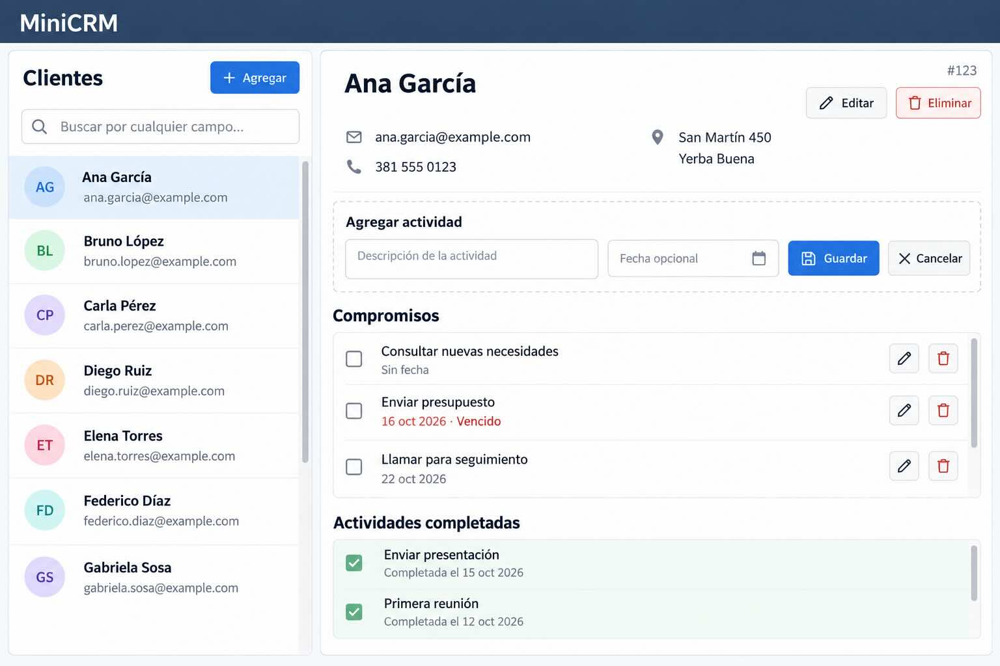

# TP4: MiniCRM.

> Fecha de entrega: *24-Oct-2026 23:59 hs*

## Objetivo: Desarrollar un mini CRM con Node.js, TypeScript, Drizzle y SQLite, implementando una API REST y una interfaz web básica usando React.

## Requisitos:

Debe hacer un MiniCRM (Customer Relationship Management) que permita gestionar clientes y sus actividades. El proyecto debe ser modular, minimalista y legible.

Debe usar como base de datos SQLite mediante Drizzle.

La funcionalidad debe implementarse en un módulo de servicio con una clase Clientes y métodos estáticos para CRUD, incluyendo búsqueda flexible por cualquier campo.

La misma debe exponerse mediante una API REST usando Express, separando controladores y routers, dejando las reglas de negocio en el servicio.

Debe implementarse una interfaz web básica en public/MiniCRM.html usando React, JSX embebido y CSS, cargando las bibliotecas desde CDN con versiones fijas. La debe implementar toda la funcionalidad usando el API REST.

La página debe organizarse como maestro y detalle, con búsqueda en vivo por cualquier campo; seleccionar un cliente muestra su ficha y sus actividades de solo lectura. El layout debe ser minimalista cuidando que se comporte como una app sin desplazamiento de página. El maestro debe tener desplazamiento vertical interno asi como las actividades del cliente. 

Debe poder agregar clientes y actividades, completar actividades y eliminar clientes. Las actividades completadas no se pueden editar ni borrar individualmente.

La edicion del formulario debe ser en el detalle. La alta y edicion de las actividades se deben hacer en un subformulario dentro del detalle del cliente.

## Referencia visual

Ejemplo ilustrativo de la interfaz. El diseño puede variar siempre que cumpla los requisitos.

..
