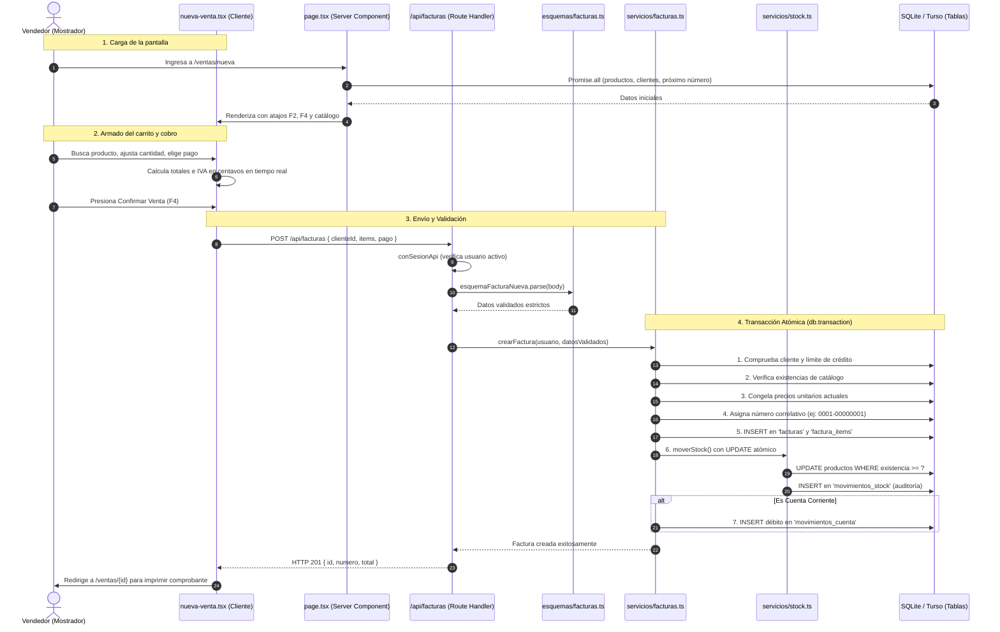

# Guía y Código Completo: Módulo de Nueva Venta (Punto de Venta)

> **Materia:** Programación IV (Segundo Parcial / TP5)  
> **Alumno:** Germán Ariel García Núñez (Legajo: 63204)  
> **Sistema:** Ferretería El Yunque - Sistema de Gestión Comercial  

---

## 1. Diagrama de Arquitectura y Flujo de Datos



---

## 2. Esquema de Base de Datos Involucrado

En este módulo intervienen **5 tablas**. Todos los importes monetarios se almacenan como **enteros en centavos** (ejemplo: `$ 1.500,50` se guarda como `150050`):

```typescript
// basedatos/esquema.ts (Extracto de tablas de venta)

// 1. Facturas emitidas (Cabecera)
export const facturas = sqliteTable("facturas", {
  id: integer("id").primaryKey({ autoIncrement: true }),
  puntoVenta: integer("punto_venta").notNull().default(1),
  numero: integer("numero").notNull(), // Correlativo sin huecos
  fecha: integer("fecha", { mode: "timestamp_ms" }).notNull(),
  clienteId: integer("cliente_id").references(() => clientes.id), // null = Consumidor Final
  usuarioId: integer("usuario_id").notNull().references(() => usuarios.id), // Vendedor
  total: integer("total").notNull(), // Importe total en centavos
  formaPago: text("forma_pago", { enum: ["contado", "tarjeta", "cuenta_corriente"] }).notNull(),
  estado: text("estado", { enum: ["emitida", "anulada"] }).notNull().default("emitida"),
});

// 2. Renglones de la Factura (Precios congelados)
export const facturaItems = sqliteTable("factura_items", {
  id: integer("id").primaryKey({ autoIncrement: true }),
  facturaId: integer("factura_id").notNull().references(() => facturas.id),
  productoId: integer("producto_id").notNull().references(() => productos.id),
  codigo: text("codigo").notNull(),
  descripcion: text("descripcion").notNull(),
  cantidad: integer("cantidad").notNull(),
  precioUnitario: integer("precio_unitario").notNull(), // CONGELADO al momento de vender
  subtotal: integer("subtotal").notNull(), // cantidad * precioUnitario
});

// 3. Auditoría de Stock (Kardex)
export const movimientosStock = sqliteTable("movimientos_stock", {
  id: integer("id").primaryKey({ autoIncrement: true }),
  productoId: integer("producto_id").notNull().references(() => productos.id),
  cantidad: integer("cantidad").notNull(), // Negativo en ventas (-1, -5)
  tipo: text("tipo", { enum: ["alta", "compra", "venta", "anulacion_venta", "ajuste"] }).notNull(),
  motivo: text("motivo").notNull(),
  facturaId: integer("factura_id").references(() => facturas.id),
  fecha: integer("fecha", { mode: "timestamp_ms" }).notNull(),
});

// 4. Cuenta Corriente de Clientes
export const movimientosCuenta = sqliteTable("movimientos_cuenta", {
  id: integer("id").primaryKey({ autoIncrement: true }),
  clienteId: integer("cliente_id").notNull().references(() => clientes.id),
  facturaId: integer("factura_id").references(() => facturas.id),
  tipo: text("tipo", { enum: ["debito", "credito"] }).notNull(), // "debito" al vender en cta cte
  importe: integer("importe").notNull(),
  descripcion: text("descripcion").notNull(),
  fecha: integer("fecha", { mode: "timestamp_ms" }).notNull(),
});
```

---

## 3. Capa de Validación con Zod (`esquemas/facturas.ts`)

```typescript
import { z } from "zod";

export const FORMAS_PAGO = ["contado", "tarjeta", "cuenta_corriente"] as const;

// Regla 9 de seguridad: NUNCA guardar el número de tarjeta completo
const esquemaTarjeta = z.strictObject({
  tipo: z.enum(["debito", "credito"], { message: "Elegí débito o crédito." }),
  marca: z.string().trim().min(1, "Elegí la marca."),
  ultimos4: z.string().regex(/^\d{4}$/, "Deben ser exactamente 4 dígitos."),
});

const esquemaPagoFactura = z.discriminatedUnion("forma", [
  z.strictObject({
    forma: z.literal("contado"),
    montoRecibido: z.number().int().positive().optional(),
  }),
  z.strictObject({
    forma: z.literal("tarjeta"),
    tarjeta: esquemaTarjeta,
  }),
  z.strictObject({
    forma: z.literal("cuenta_corriente"),
  }),
]);

const esquemaItem = z.strictObject({
  productoId: z.number().int().positive(),
  cantidad: z.number().int().positive("La cantidad debe ser mayor que cero."),
});

export const esquemaFacturaNueva = z.strictObject({
  clienteId: z.number().int().positive().nullable(), // null = Consumidor Final
  items: z
    .array(esquemaItem)
    .min(1, "La venta debe tener al menos un producto.")
    .refine(
      (items) => new Set(items.map((i) => i.productoId)).size === items.length,
      "Hay productos repetidos en el detalle.",
    ),
  pago: esquemaPagoFactura,
});
```

---

## 4. Servicio Backend y Transacción Atómica (`servicios/facturas.ts`)

Este método ejecuta la transacción SQLite/Turso. Si falla cualquier condición, se revierte todo:

```typescript
export async function crearFactura(usuarioVendedor: UsuarioSesion, datos: DatosFacturaNueva) {
  const compraCliente = esquemaFacturaNueva.parse(datos);

  return await db.transaction(async (tx) => {
    // 1. Obtener productos de la base de datos
    const ids = compraCliente.items.map((item) => item.productoId);
    const productosDb = await tx.select().from(productos).where(inArray(productos.id, ids));
    const mapaProductos = new Map(productosDb.map((p) => [p.id, p]));

    // 2. Verificar que todos existan y estén activos
    for (const item of compraCliente.items) {
      const prod = mapaProductos.get(item.productoId);
      if (!prod || !prod.activo) {
        throw new ApiError(422, "El producto no está disponible para la venta.");
      }
    }

    // 3. Regla 6: Validar comprador en cuenta corriente
    let clienteComprador = null;
    if (compraCliente.clienteId !== null) {
      clienteComprador = await tx.select().from(clientes).where(eq(clientes.id, compraCliente.clienteId)).get();
    }
    if (compraCliente.pago.forma === "cuenta_corriente") {
      if (!clienteComprador || !clienteComprador.cuentaCorriente) {
        throw new ApiError(422, "Solo clientes registrados y habilitados pueden comprar en cuenta corriente.");
      }
    }

    // 4. Regla 1: Validar existencias
    for (const item of compraCliente.items) {
      const prod = mapaProductos.get(item.productoId)!;
      if (prod.existencia < item.cantidad) {
        throw new ApiError(409, `Stock insuficiente para ${prod.descripcion}. Disponible: ${prod.existencia}`);
      }
    }

    // 5. Regla 3: Congelar precio unitario del catálogo y calcular subtotales
    const renglonesCalculados = compraCliente.items.map((item) => {
      const prod = mapaProductos.get(item.productoId)!;
      const precioUnitario = prod.precio; // <- Congelado
      return {
        productoId: prod.id,
        codigo: prod.codigo,
        descripcion: prod.descripcion,
        cantidad: item.cantidad,
        precioUnitario,
        subtotal: precioUnitario * item.cantidad,
      };
    });
    const totalFactura = renglonesCalculados.reduce((acc, r) => acc + r.subtotal, 0);

    // 6. Regla 6: Control de límite de crédito
    if (compraCliente.pago.forma === "cuenta_corriente" && clienteComprador) {
      const saldoActual = await calcularSaldoCliente(tx, clienteComprador.id);
      if (clienteComprador.limiteCredito !== null && (saldoActual + totalFactura) > clienteComprador.limiteCredito) {
        throw new ApiError(422, "La compra excede el límite de crédito disponible del cliente.");
      }
    }

    // 7. Regla 4: Asignar número correlativo sin saltos
    const proximoNumero = await calcularProximoNumeroFactura(tx);

    // 8. Insertar cabecera en 'facturas'
    const [facturaInsertada] = await tx
      .insert(facturas)
      .values({
        puntoVenta: 1,
        numero: proximoNumero,
        fecha: new Date(),
        clienteId: compraCliente.clienteId,
        usuarioId: usuarioVendedor.id,
        total: totalFactura,
        formaPago: compraCliente.pago.forma,
        estado: "emitida",
      })
      .returning();

    // 9. Insertar ítems en 'factura_items'
    await tx.insert(facturaItems).values(
      renglonesCalculados.map((r) => ({
        facturaId: facturaInsertada.id,
        ...r,
      })),
    );

    // 10. Descontar stock atómicamente con moverStock()
    for (const r of renglonesCalculados) {
      await moverStock(tx, {
        productoId: r.productoId,
        cantidad: -r.cantidad, // Salida de stock
        tipo: "venta",
        motivo: `Factura 0001-${String(proximoNumero).padStart(8, "0")}`,
        usuarioId: usuarioVendedor.id,
        facturaId: facturaInsertada.id,
      });
    }

    // 11. Registrar débito en cuenta corriente si corresponde
    if (compraCliente.pago.forma === "cuenta_corriente" && clienteComprador) {
      await tx.insert(movimientosCuenta).values({
        clienteId: clienteComprador.id,
        facturaId: facturaInsertada.id,
        tipo: "debito",
        importe: totalFactura,
        descripcion: `Factura 0001-${String(proximoNumero).padStart(8, "0")}`,
        fecha: new Date(),
      });
    }

    return facturaInsertada;
  });
}
```

---

## 5. Control Atómico de Concurrencia (`servicios/stock.ts`)

Para evitar que dos vendedores vendan la última unidad al mismo tiempo:

```typescript
// SQL atómico: solo descuenta si la existencia actual es suficiente
export async function moverStock(tx: Conexion, mov: DatosMovimientoStock) {
  if (mov.cantidad < 0) {
    const unidadesARestar = Math.abs(mov.cantidad);
    const resultado = await tx
      .update(productos)
      .set({
        existencia: sql`${productos.existencia} - ${unidadesARestar}`,
      })
      .where(and(eq(productos.id, mov.productoId), gte(productos.existencia, unidadesARestar)));

    if (resultado.rowsAffected === 0) {
      throw new ApiError(409, "Conflicto de concurrencia: el stock fue modificado por otra venta simultánea.");
    }
  }

  // Graba el movimiento en el historial
  await tx.insert(movimientosStock).values({
    productoId: mov.productoId,
    cantidad: mov.cantidad,
    tipo: mov.tipo,
    motivo: mov.motivo,
    facturaId: mov.facturaId ?? null,
    fecha: new Date(),
  });
}
```

---

## 6. Preguntas y Respuestas para el Examen Oral sobre este Módulo

| Pregunta de Defensa | Respuesta Didáctica |
|---|---|
| **¿Dónde se asegura que una factura se grabe completa o nada?** | En `servicios/facturas.ts` dentro de `db.transaction(async (tx) => { ... })`. Si falla cualquier ítem o validación, se revierte todo automáticamente. |
| **¿Por qué el cliente web no envía el precio unitario ni el total?** | Por seguridad. Si el frontend enviara el precio, un usuario malicioso podría alterar la petición con las herramientas de desarrollador y comprar a \$0. El servidor busca el precio oficial en el catálogo. |
| **¿Qué pasa con las facturas emitidas si mañana cambia el precio de un producto?** | Nada. La tabla `factura_items` tiene su propia columna `precio_unitario` que congela el valor al momento exacto de la emisión. |
| **¿Dónde se impide vender en cuenta corriente a un consumidor final?** | En `servicios/facturas.ts` (Paso 3) y en el frontend: se exige que el comprador sea un cliente con ID y con el campo `cuentaCorriente: true`. |
| **¿Cómo se evita que dos vendedores vendan la última unidad simultáneamente?** | Con la condición atómica `WHERE existencia >= ?` en el UPDATE de `servicios/stock.ts`. La primera venta actualiza y la segunda falla con 0 filas afectadas, disparando un error 409 y abortando la transacción. |
| **¿Cómo se guardan los importes de dinero?** | En números enteros en **centavos** (`integer`), multiplicando por 100. Nunca usamos punto flotante (`float`) para evitar errores de redondeo financiero de JavaScript/SQLite. |
